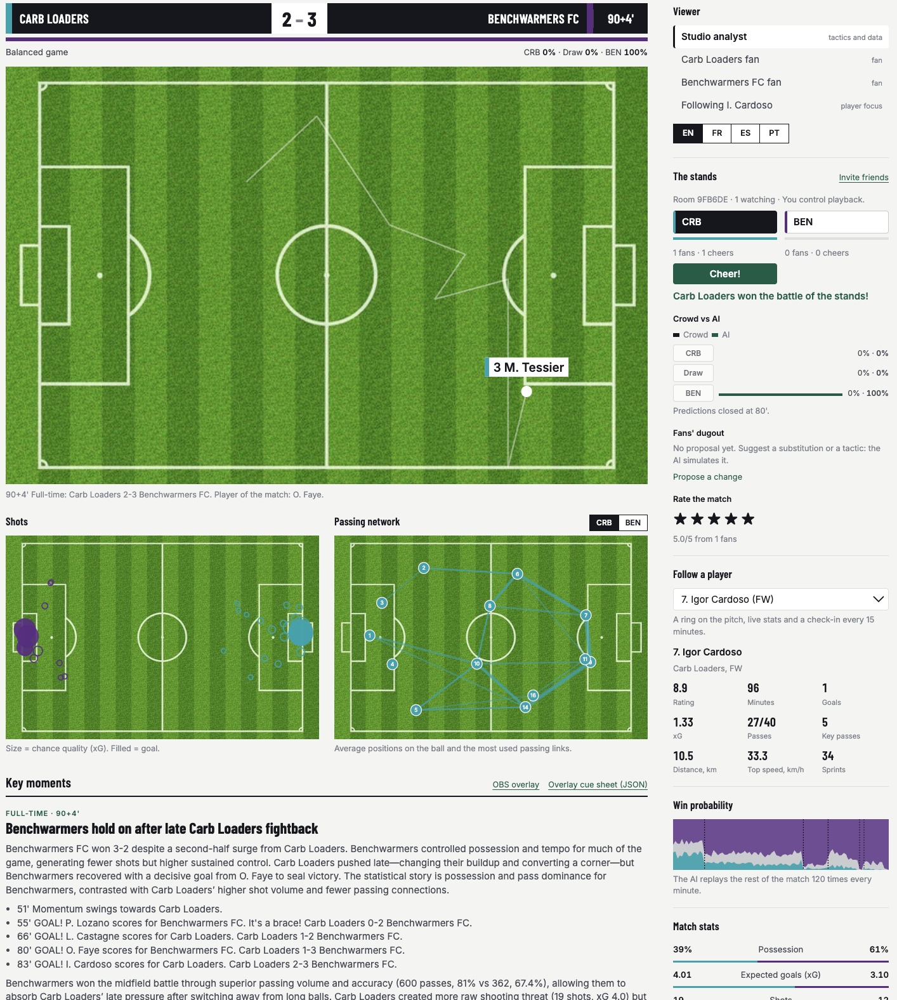
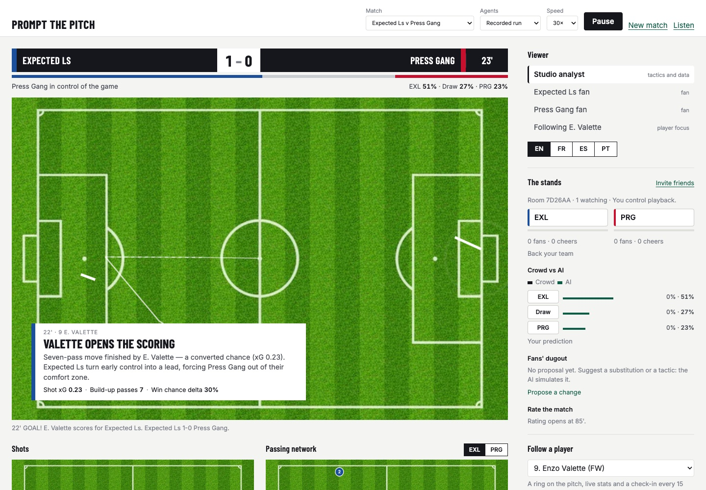
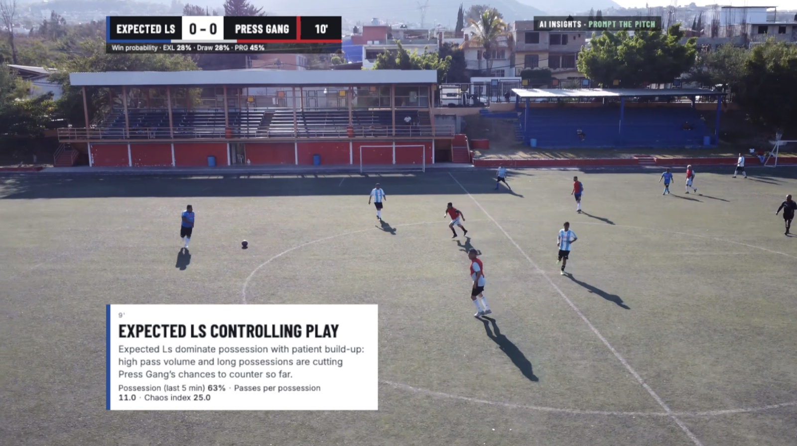
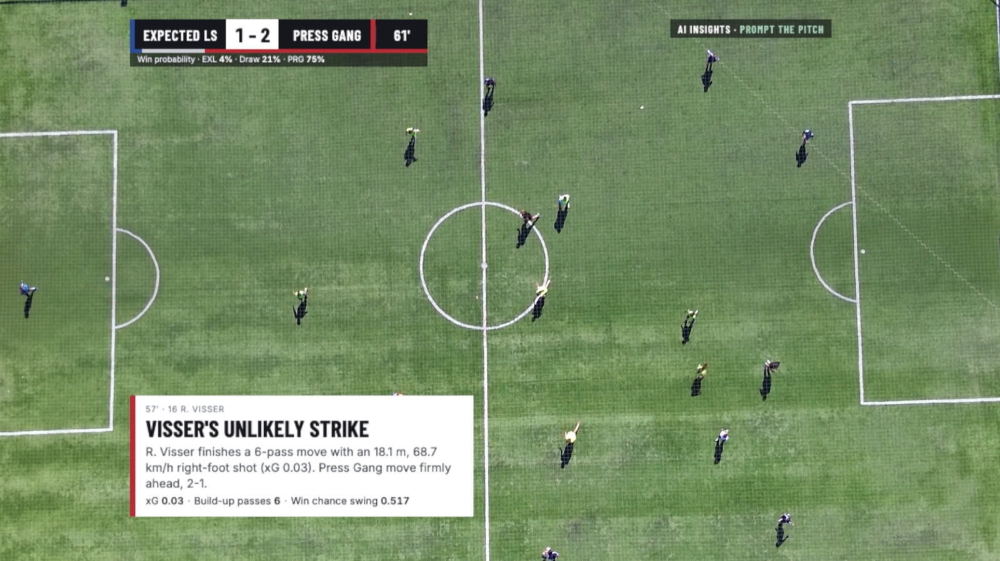
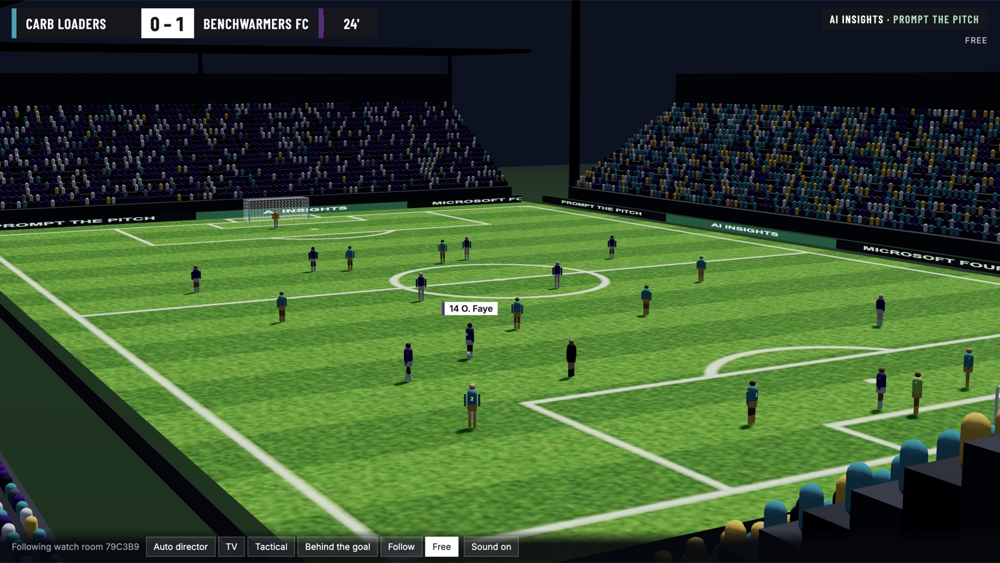
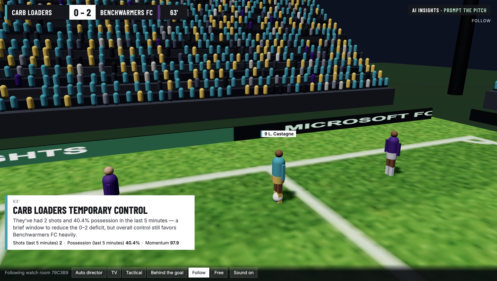
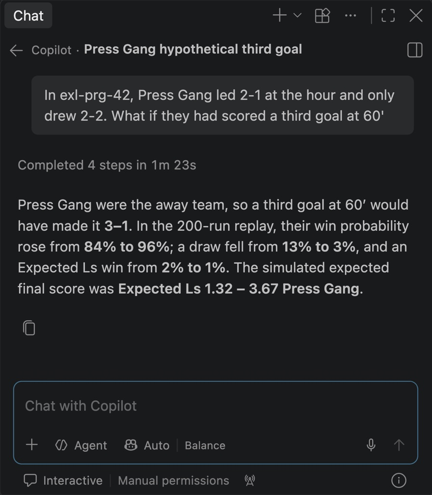
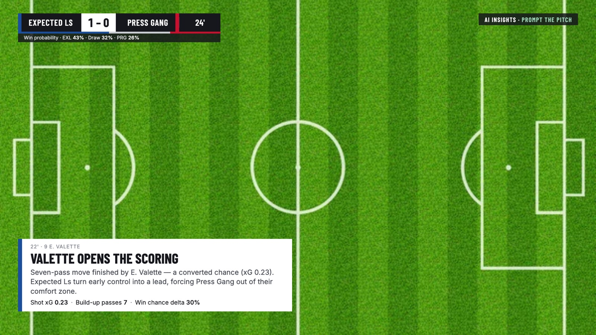
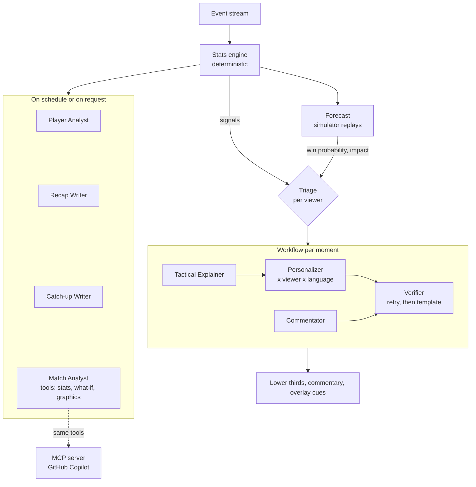
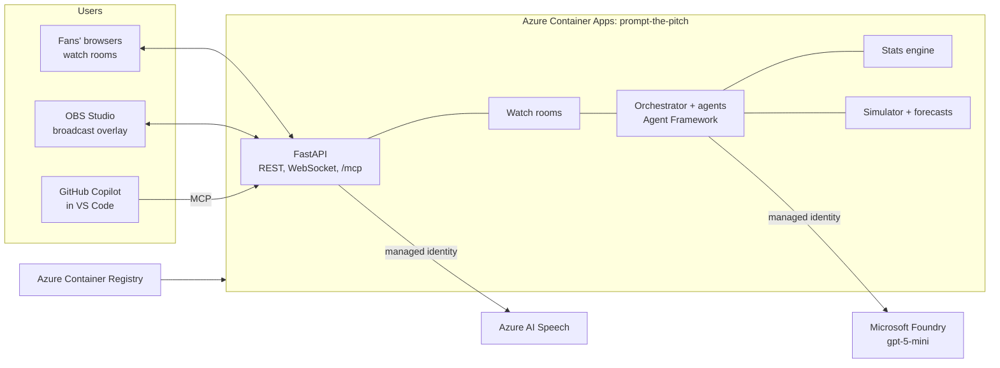

# Prompt the Pitch

**A team of AI agents that explains football as it happens: for every viewer, in their
language, on any screen.**

Built for the Microsoft × Premier League *Inside the Game* hackathon with **Microsoft Agent
Framework**, **Microsoft Foundry**, **Azure Container Apps**, **Azure AI Speech** and
**GitHub Copilot (MCP)**.

**Live demo:** https://prompt-the-pitch.bluemeadow-45cc0d52.swedencentral.azurecontainerapps.io
(no sign-in: pick a match, keep *Recorded run*, press **Kick off**)

**Demo video (under 2 minutes):** https://www.youtube.com/watch?v=KJLt3ywamow



---

## Contents

1. [The idea](#the-idea)
2. [At a glance](#at-a-glance)
3. [A tour in pictures](#a-tour-in-pictures)
4. [Features](#features)
5. [The multi-agent system](#the-multi-agent-system)
6. [Synthetic data, built as a product](#synthetic-data-built-as-a-product)
7. [The stats engine](#the-stats-engine)
8. [Win probability, impact and what-if](#win-probability-impact-and-what-if)
9. [Real-time architecture](#real-time-architecture)
10. [Azure deployment and security](#azure-deployment-and-security)
11. [Microsoft technologies](#microsoft-technologies)
12. [Quality and evaluation](#quality-and-evaluation)
13. [Responsible by design](#responsible-by-design)
14. [Run it locally](#run-it-locally)
15. [API reference](#api-reference)
16. [Repository layout](#repository-layout)
17. [Appendix: every metric and formula](#appendix-every-metric-and-formula)

---

## The idea

A broadcast shows the same graphics to millions of people. Yet a studio analyst, a casual fan,
a supporter of the other team and a fan who only follows one player do not want the same
explanation, and not in the same language. Clubs and broadcasters already have a rich event
feed (thousands of passes, pressures and sprints per match), but turning it into words live
takes analysts and graphics operators that only the biggest productions can afford.

**Prompt the Pitch** reads the live event stream of a match and:

1. computes the statistics a data analyst would (xG, pressing, momentum, tactical shifts) with
   a deterministic **stats engine**;
2. decides which moments matter, and **for whom** (triage per viewer);
3. has a **team of AI agents** explain each moment: why it matters, a commentary line, and a TV
   lower third written for each viewer, in their language, with every number checked;
4. **replays the rest of the match** hundreds of times to show live win probabilities, how much
   each moment mattered, and to answer "what if?";
5. brings people together in **watch rooms**, and brings the same intelligence to
   **broadcasters** (an OBS overlay) and **developers** (GitHub Copilot through MCP).

## At a glance

| | |
|---|---|
| Viewer feeds per match | **16**: 4 roles (studio analyst, home fan, away fan, player focus) × 4 languages (EN, FR, ES, PT) |
| Agents | **9**: 7 language agents and 2 code agents, orchestrated per moment with Microsoft Agent Framework workflows |
| Agent calls in a recorded match | **≈ 1,000**, of which **99%+ accepted first time** by the Verifier |
| Win probability | the rest of the match replayed **120 times every minute** |
| What-if | **200** replays with and **200** without the scenario, same random seeds |
| 3D stadium | live in sync with the watch room: 22 players, referee, ≈ 8,000 animated fans, 5 cameras and an auto director |
| Events per synthetic match | **≈ 2,500**, with coordinates, speeds and a per-minute physical feed |
| API keys | **0**: Microsoft Entra ID and managed identity only |
| Tests | **47**, run offline in GitHub Actions on every push |

## A tour in pictures

**One goal, explained for the studio analyst.** The lower third is written by the agents, the
figures come from the stats engine, and the win-chance change from the simulator.



**The same graphics, live in OBS Studio over a match feed.** The broadcast overlay is a
transparent page that follows a watch room; OBS composites it over any video.

<table>
  <tr>
    <td></td>
    <td></td>
  </tr>
  <tr>
    <td align="center"><sub>A tactical moment at 9': possession, passes per possession, chaos index</sub></td>
    <td align="center"><sub>The go-ahead goal at 57': xG 0.03, and the win-chance swing measured by the simulator</sub></td>
  </tr>
</table>

<sub>Illustrative footage of amateur football (Pexels); the graphics come from a synthetic match.</sub>

**The match in a 3D stadium, in sync with the watch room.** The same match, the same minute and
the same AI lower thirds, in a stadium with an animated crowd, floodlights, a referee and five
cameras cut by an automatic director.

<table>
  <tr>
    <td></td>
    <td></td>
  </tr>
  <tr>
    <td align="center"><sub>Free camera over the stadium, following a watch room</sub></td>
    <td align="center"><sub>Follow camera on the ball carrier, with the analyst's lower third</sub></td>
  </tr>
</table>

**The match intelligence inside GitHub Copilot.** Copilot calls the MCP tools, replays the match
200 times with and without the scenario, and answers with the real numbers.

<p align="center">
  
</p>

## Features

### For fans

- **Pick a viewer.** *Studio analyst* (tactics and data), *home fan*, *away fan*, or *follow one
  player*, in English, French, Spanish or Portuguese. Every lower third, recap and answer is
  written for that viewer: the level of detail, the point of view ("we" for a fan), the language.
  The whole interface is translated too.
- **Follow any player.** A ring on the pitch, a live player card (rating, xG, passes, key passes,
  distance, top speed, sprints) and an AI **check-in every 15 minutes** (15', 30', half-time, 60',
  75', full-time): what the player has done, how well, and what is missing.
- **What you missed.** Join late or come back to the tab after a while: the Catch-up Writer
  summarises the moments you missed, for your profile and language.
- **Listen.** Spoken lower thirds, recaps, catch-ups and answers, with **Azure AI Speech** neural
  voices in the four languages (the browser voice is the fallback).
- **Ask the analyst.** Questions in any of the four languages, answered with live statistics,
  simulations and graphics drawn on the pitch.

### Watch rooms

Every match runs in a room with a short code. **Invite friends** shares a link to the same room.

- **One match, many fans.** The first fan is the host and controls playback (pause, speed);
  everyone else watches in sync. Late arrivals get the match so far (history, latest stats).
- **The battle of the stands.** Back a team and cheer; the stand with more fans and cheers wins.
- **Crowd vs AI.** Predict the result (until 80'); the room's predictions are shown against the
  AI's live win probability.
- **The fans' dugout.** Propose a substitution or a tactical change for a team; the simulator
  replays the rest of the match with it, and the room votes. Each proposal shows its effect on
  the team's chances.
- **Rate the match** from 85'.
- Nicknames are random ("Lucky Libero"): no account, no personal data.

### For analysts

- **Live win probability**: home, draw, away, updated every minute, with a chart for the match.
- **How much a moment mattered**: for goals, big chances, big saves and red cards, the match is
  replayed with and without the moment ("this goal lifted Press Gang's chances from 38% to 89%").
- **What if?** "What if Press Gang had scored at 60'?", "what if Expected Ls switched to a high
  press now?", "what if Teixeira came on?": the analyst agent turns the question into a scenario
  and the simulator answers.
- **Broadcast graphics on demand**: the analyst agent draws a **shot map**, a **passing
  network**, a player's **touches** or a **pressing map** on the pitch to illustrate its answer.
- **Shot map and passing networks** for both teams, live, under the pitch.
- **Match stats**: possession, xG, shots, passes, pass accuracy and difficulty, PPDA, distance.

### For broadcasters

- **Broadcast overlay for OBS Studio** (`/broadcast.html`): scorebug with clock, win-probability
  bar, lower thirds, recaps and player check-ins on a transparent 1920 × 1080 page. It joins a
  watch room as an *observer* (never the host, never counted as a fan), so the graphics stay in
  sync with the room. Parameters choose the room or match, language, viewer and followed player;
  `&preview=1` draws a pitch behind the graphics to check them in a browser.
- **Overlay cue sheet** (`/api/matches/{id}/overlays`): every lower third of a recorded run as
  self-contained, timed cues (match clock, duration, template, title, body, figures, highlighted
  player), ready for a graphics engine.



### 3D stadium

`/stadium.html` plays the match in a 3D stadium built with three.js, right in the browser.

- **In sync with the watch room.** The **3D stadium** link above the key moments opens the room
  in 3D: it joins as an observer and follows the room's clock, pauses and speed, with the room's
  AI lower thirds. On its own (`?match=exl-prg-42`) it has its own playback, a timeline and a
  button per goal.
- **A stadium that reacts.** Four stands with about 8,000 fans in the club colours (each end
  behind its team), animated on the GPU: they bob through the match, get livelier near the goals
  and jump when their team scores. Floodlights, advertising boards, goals with nets, a referee
  who trails the play.
- **Players that run.** Twenty-two players in their kits, with numbers on their backs, running
  strides, arms and facing, and the name of the player on the ball. Goalkeepers wear their own
  colours.
- **Five cameras and an auto director.** *TV* (high on the main stand), *Tactical* (from above),
  *Behind the goal*, *Follow* (behind the ball carrier) and *Free* (orbit with the mouse). The
  auto director cuts behind the goal on shots and corners, circles the scorer after a goal and
  goes wide at kick-off.
- **Stadium sound.** A crowd bed that swells near the goals, an "ooh" on chances, a roar on
  goals, and the referee's whistle for fouls, offsides, penalties, kick-offs, half-time and full
  time, all synthesised with Web Audio.
- **Positions rebuilt from the events.** The simulator records events, not where the other 21
  players were. `itg/tracking.py` places every player at every event (the actor on the ball, the
  receiver where the pass arrives, the others at their formation slot shifted with the ball and
  possession), then makes runs start early so that nobody moves faster than a sprint
  ([formulas](#x-tracking-for-the-3d-stadium)). It runs after the simulation, so the matches,
  statistics and recorded agent runs are untouched.

### For developers: GitHub Copilot through MCP

The app serves its match intelligence as a **Model Context Protocol** server at `/mcp`
(streamable HTTP, stateless). The repository ships [`.vscode/mcp.json`](.vscode/mcp.json): open
the folder in VS Code, start the server, switch Copilot Chat to **Agent** mode and ask.

| Tool | Returns |
|---|---|
| `list_matches` | Recorded matches with their final score, and the watch rooms open right now |
| `get_match_state` | Score, clock, momentum, game phase, win probabilities |
| `get_team_stats` / `get_player_stats` | Live team or player statistics |
| `get_top_players` | Players ranked by a metric (rating, xG, passes, distance, top speed…) |
| `get_key_moments` | Key moments with why they mattered and their effect on win chances |
| `get_win_probability_timeline` | Win probability minute by minute, as rows ready to chart |
| `get_shot_map` / `get_pass_network` | Coordinates ready to plot |
| `simulate_what_if` | Goal, red card, tactic or substitution, replayed and compared |

Every tool takes a `room` (the state the room has reached, so no spoilers) or a `match_id` with
an optional `minute`. The tools wrap the analyst agent's own tools and never call a model, so they
cost nothing in Foundry; what-if replays are rate limited. Details in [docs/mcp.md](docs/mcp.md).

## The multi-agent system

The rule is simple: **numbers come from code, words come from agents.** The stats engine and
the simulator produce every figure; the agents explain them; the Verifier makes sure no agent
ever writes a number that is not in its input.



### The team

| Agent | Kind | Input | Output (typed) |
|---|---|---|---|
| **Orchestrator** | Code | Event stream, viewer profiles | Triage, concurrency, schedules, shared memory |
| **Tactical Explainer** | LLM | Moment brief: signal, evidence, live stats, game phase, win probability, impact, recent moments | `Insight`: why it matters, tactical theme, key numbers, analyst note |
| **Commentator** | LLM | Moment brief and the previous lines | `Commentary`: one broadcast line |
| **Personalizer** | LLM, one per viewer and language | Brief, insight, viewer profile | `OverlayCard`: title, body, why, analyst note, stat chips, highlighted player, priority |
| **Player Analyst** | LLM, one per followed player and language | Player stats and the moments involving them | `PlayerReport`: headline, summary, key stats |
| **Recap Writer** | LLM, one per viewer and language | Half-time or full-time summary and the match memory | `Recap`: headline, summary, tactical story, key moments |
| **Catch-up Writer** | LLM, on request | Score now, win probability, moments missed | `CatchUp`: headline, summary, key points |
| **Match Analyst** | LLM with 10 tools | A fan's question | Answer, plus an optional pitch graphic |
| **Verifier** | Code | Every agent output and its input | Accept, or the list of issues |

### One moment, end to end

1. **Triage.** The orchestrator decides, for each viewer, whether the signal deserves a lower
   third: the threshold depends on the viewer's role, club and player ([formula](#p-triage)).
   Analysts see more tactics, casual fans more spectacle.
2. **Impact.** For goals, big chances, big saves and red cards, the simulator measures how much
   the moment changed the team's chances, and the result is added to the evidence.
3. **Workflow.** A Microsoft Agent Framework `Workflow` runs the moment: the **Tactical
   Explainer** and the **Commentator** start in parallel (fan-out); the explanation is handed off
   to one **Personalizer** per viewer and language, which also run in parallel; the results are
   assembled (fan-in) into a `MomentResult`.
4. **Guard.** Every language-agent call goes through the same guard: structured output
   (Pydantic), Verifier check, **one retry with the Verifier's feedback**, then a deterministic
   **template** if it still fails, times out or Foundry is unreachable. The screen never goes
   blank. Each step is recorded in the moment's trace (agent, status, latency, reason).
5. **Delivery.** Each viewer's lower third is sent with its display time (12 s for high priority,
   8 s normal, 5 s low) and a timed cue for graphics engines.

### Orchestration

- **Concurrency.** Up to 4 moments are processed at once; Foundry calls are capped at 16 in
  parallel; a rate-limited call (HTTP 429) waits 3, 6 then 12 seconds before retrying.
- **Schedules.** Win probability every match minute; player check-ins at 15', 30', half-time,
  60', 75' and full-time; recaps at half-time and full-time (after pending moments finish).
- **Shared memory.** Processed moments feed the Commentator (continuity: no repeated lines), the
  Recap Writer (a story, not a list), the Catch-up Writer and the Match Analyst.
- **Live or recorded.** *Live on Foundry* runs the agents as the match plays, writing only the
  languages and players someone is watching. *Recorded run* replays a saved run in perfect sync
  with no model call at all; recordings contain all 16 feeds and every player's check-ins.
- **Prompts.** Each agent gets a compact JSON brief with player names (never ids), the evidence
  and the win-probability impact, and is asked to quantify why a moment matters, to use only the
  numbers given, and to write in the viewer's language and point of view. Reasoning effort is
  set to *minimal* to keep latency low.

### Measured on the two recorded demo matches

| | Expected Ls 2-2 Press Gang | Carb Loaders 2-3 Benchwarmers FC |
|---|---|---|
| Moments explained | 33 | 37 |
| Lower thirds written | 356 | 412 |
| Player check-ins | 137 | 134 |
| **Agent calls** | **1,002** | **1,054** |
| Accepted first time | 998 (99.6%) | 1,045 (99.1%) |
| Corrected after Verifier feedback | 4 | 7 |
| Replaced by a template | 0 | 2 |

More in [docs/agents.md](docs/agents.md).

## Synthetic data, built as a product

The hackathon asks for synthetic, football-realistic data. We treated it as a core piece of
engineering, not a placeholder: a ball-by-ball **match simulator** (`itg/synthetic/`) that
produces the kind of event and tracking feed clubs and broadcasters buy.

**Why it matters**

- **Free of rights by construction.** Real event data, player names and footage are licensed.
  Our league, clubs and players are invented, so every match, overlay and recording can be
  published, replayed and shared openly.
- **A ground truth.** Each match hides one or two tactical changes. Because we know the truth,
  we can **score our own analysis** instead of guessing (see
  [Quality and evaluation](#quality-and-evaluation)). Real data has no such labels.
- **A future that can be replayed.** The simulator restarts from any moment of a match. That is
  what powers the live win probability, the impact of each moment and every *what if*:
  something recorded matches cannot offer.
- **Reproducible and unlimited.** The same seed always gives the same match; any two clubs can
  meet; the tests and the CI run on generated matches; **New match** creates one in the app.

**How the simulator works**

The simulator follows the ball. At each step the player in possession may be pressed, then
shoots, carries or passes (set pieces have their own rules); the defending team presses,
tackles, intercepts and blocks. Every probability depends on:

- **player ratings** (pace, passing, dribbling, finishing, defending, goalkeeping, stamina),
  eroded by **fatigue**;
- the **team style** (possession, pressing, directness, each between 0 and 1);
- a hidden **momentum** that drifts minute by minute and jumps after goals;
- the **scoreline**: late in the match, trailing teams push and leading teams sit deeper;
- **red cards**: a team down to ten presses less, passes worse and leaves more space;
- **hidden tactical shifts** (high press, low block, direct play, possession control) that start
  at a random minute and change the style.

It also emits a per-minute **physical feed** for every player (distance, top speed, sprints).
The exact models are in the [appendix](#v-the-simulators-models).

| Club | Formation | Possession | Pressing | Directness | Identity |
|---|---|---|---|---|---|
| Expected Ls (EXL) | 4-3-3 | 0.75 | 0.60 | 0.25 | Patient possession |
| Press Gang (PRG) | 4-2-3-1 | 0.50 | 0.85 | 0.45 | Aggressive high press |
| Carb Loaders (CRB) | 4-4-2 | 0.35 | 0.40 | 0.75 | Direct, long balls |
| Benchwarmers FC (BEN) | 4-2-3-1 | 0.55 | 0.55 | 0.45 | Balanced |

**Calibrated against top-flight football** (`python -m scripts.calibrate --matches 20`, per team
and match):

| Statistic | Simulated | Top-flight reference |
|---|---|---|
| Passes | 509 | 480 |
| Pass completion | 78% | 82% |
| Shots | 12.9 | 13 |
| Shots on target | 4.9 | 4.5 |
| Goals | 1.65 | 1.4 |
| Corners | 6.0 | 5 |
| Fouls | 11.1 | 11 |
| Tackles | 14.1 | 17 |
| Interceptions | 13.9 | 10 |
| Pressures | 137 | 150 |
| Events per match | 2,531 | 2,500 |

**Rich events.** About 2,500 events per match: passes (length, ball speed, height, cross, under
pressure, offside), carries, dribbles, pressures, shots (situation, body part, distance, speed),
goals with assists, fouls, cards, substitutions, restarts, and the physical feed. The format is
documented in [docs/synthetic-data.md](docs/synthetic-data.md).

## The stats engine

`itg/stats/engine.py` turns the event stream into live football intelligence, one event at a
time (a whole match of 2,445 events is processed in about 0.06 s). It is deterministic and uses
no AI: numbers must be exact and instant, and the agents explain them afterwards.

- **Counting**: possession, passes, pass accuracy and **difficulty**, **pass value added**,
  progressive passes and carries, final-third and box entries, crosses, long balls, shots, **xG**,
  key passes, **xA**, big chances, corners, fouls, cards, pressures, **PPDA**, tackles,
  interceptions, distance, top speed, sprints, a **player rating**.
- **Rolling analysis every minute**: **momentum** (−100 to +100), the **control-vs-chaos**
  phase, and **tactical shifts** found by a change-point test on pressing height and directness.
- **Signals**: about 50 key-moment candidates per match, each with an importance between 0 and
  1, a factual headline and the evidence behind it: goal (opener, equaliser, go-ahead, comeback,
  late, brace), big chance, big save, penalty, card, thunderbolt, defence-splitting pass, pass
  sequence, high turnover, counter-attack, speed alert, distance milestone, momentum swing,
  dominance, phase change, tactical shift, half-time, full-time.
- **Graphics data**: a shot map and each team's passing network (average positions on the ball,
  most used links).

Every definition is in the [appendix](#appendix-every-metric-and-formula); more in
[docs/stats-engine.md](docs/stats-engine.md).

## Win probability, impact and what-if

Because the matches come from our own simulator, the future can be replayed.

- **Live win probability.** Every minute, what the stats engine knows (score, time left, players
  on the pitch, red cards, momentum, and the tactical changes it has *detected*) becomes a
  simulator state, and the rest of the match is played 120 times. The hidden ground truth is
  never given to the forecast.
- **How much a moment mattered.** A goal is compared with the same match without it; a big chance
  or a big save with the same match had it been scored; a red card with the same match at eleven.
  Both sides use the **same random seeds**, so the difference comes from the moment, not luck.
- **What if?** The analyst agent's `simulate_what_if` tool and the fans' dugout apply a scenario
  (goals added or removed, red cards, a new tactic, a substitution) from now or from a past
  minute, and compare 200 replays with and without it. In a watch room a scenario can never start
  after the minute the room has reached.

Formulas in the appendix: [Q](#q-win-probability), [R](#r-moment-impact), [S](#s-what-if).
More in [docs/forecast.md](docs/forecast.md).

## Real-time architecture



- **One WebSocket per viewer** (`/ws/matches/{id}`), one **room** per match session. The room
  replays the event stream at the chosen speed (1× to 120×) and broadcasts events, a snapshot of
  the stats every second, signals, moments, recaps, check-ins, forecasts and the room's social
  state. Answers from the analyst go only to the fan who asked.
- **Late joiners** receive the match so far (setup, history of moments, recaps, check-ins and
  forecasts, latest stats). The host role passes to the next fan when the host leaves; an empty
  room closes after 30 seconds (a page reload keeps it).
- **Timing.** Live agents need a few seconds per moment, so live rooms play at 10× (about one
  match minute behind); recorded runs play in perfect sync. A lower third that has become stale
  is dropped: more than 150 match seconds old for a recorded run, more than 20 seconds of waiting
  in a live room.
- **No build step.** The front end is plain HTML, CSS and JavaScript modules (`web/`), translated
  into four languages (`web/i18n.js`).

## Azure deployment and security

The app runs as one container on **Azure Container Apps** (Sweden Central), built and deployed by
[`infra/deploy.sh`](infra/deploy.sh), which is idempotent.

| Resource | Purpose |
|---|---|
| Microsoft Foundry resource and project | The `gpt-5-mini` deployment behind every agent; its custom domain also serves Azure AI Speech |
| Azure Container Apps (environment + app) | 1 vCPU, 2 GiB, one replica always on (watch rooms live in memory), HTTPS and WebSockets |
| Azure Container Registry (Basic) | The image, pulled by the app's managed identity |
| Log Analytics | Container logs |

**Security**

- **No API key anywhere**, not in the code, the image or the configuration. Locally the app signs
  in with `az login`; on Azure it uses the container app's **system-assigned managed identity**,
  with the **Foundry User** role on the Foundry resource and **AcrPull** on the registry.
- Azure AI Speech is called on the Foundry resource's custom domain with a Microsoft Entra token;
  the text is escaped before it goes into SSML.
- The site and the MCP endpoint only expose synthetic, public data; the MCP tools are read-only.

**Cost guards on the public site**: at most 3 live rooms at a time (extra viewers get the recorded
run), 25 questions per fan and match, 20 proposals per room, what-if replays limited to 2 at a time
and 20 a minute on MCP, and recorded runs that replay without any model call. More in
[docs/deployment.md](docs/deployment.md).

## Microsoft technologies

| Technology | How it is used |
|---|---|
| **Microsoft Agent Framework** | All agents (`Agent`, `FoundryChatClient`), structured outputs, tool calling for the Match Analyst, and the per-moment `Workflow` with fan-out, handoff and fan-in edges |
| **Microsoft Foundry** | Project and `gpt-5-mini` deployment behind every agent |
| **Microsoft Entra ID, managed identity** | Keyless authentication to Foundry, Speech and the registry |
| **Azure Container Apps** | Hosting: REST, WebSocket watch rooms, MCP endpoint, static front end |
| **Azure Container Registry** | Container images |
| **Azure AI Speech** | Neural voices (`en-GB-RyanNeural`, `fr-FR-HenriNeural`, `es-ES-AlvaroNeural`, `pt-PT-DuarteNeural`) with SSML |
| **Azure Monitor / Log Analytics** | Logs and revision health |
| **GitHub Copilot agent mode + MCP** | The match intelligence as tools in the developer's editor (official MCP Python SDK) |
| **GitHub Actions** | Tests, calibration report and image build on every push |

## Quality and evaluation

**Tests.** 47 tests run offline (no Foundry) in GitHub Actions:

| File | What it checks |
|---|---|
| `tests/test_synthetic.py` (10) | Same seed same match, complete squads, ordered events, coordinates on the pitch, score matches goals, statistics look like real football |
| `tests/test_stats.py` (9) | xG and pass difficulty are sensible, frames flip at half-time, counts match the stream, players add up to teams, every goal raises a signal, momentum is bounded, hidden tactical shifts are detected |
| `tests/test_forecast.py` (5) | Probabilities add up, late leads hold, scenarios move the forecast the right way, lineups change, goal impact is positive |
| `tests/test_agents.py` (13) | Verifier flags invented numbers and long texts, a rejected answer is fixed after feedback, a failing agent falls back without breaking the moment, workflow branches run in parallel, triage depends on the viewer, chat tools answer from the live state, rate limits back off, no what-if spoilers |
| `tests/test_tracking.py` (1) | 3D tracking: ordered frames, at most 22 players, the ball on the pitch, 99% of runs below sprint speed, every goal present |
| `tests/test_api.py` (9) | REST, a whole match over WebSocket, shared watch rooms, live room cap, speech escaping, cue sheet, MCP server |

**Detection against the hidden ground truth** (`python -m scripts.evaluate_detection`, 60
matches; a detection counts when it is the same team and kind of change, from 2 minutes before to
15 minutes after the hidden change):

| Hidden change | Detected |
|---|---|
| High press | 15 / 20 |
| Low block | 20 / 35 |
| Direct play | 5 / 22 |
| Possession control | 2 / 19 |

Pressing changes are found reliably. Changes in passing style are harder to prove: a team plays
only about two passes a minute from its own half, too little data in 15 minutes for a confident
test (overall recall 44%, 1.2 extra detections per match, some of them genuine changes caused by
fatigue, red cards or the scoreline). The ground truth shows exactly where to improve next.

**The Verifier, measured.** Over the two recorded matches, 11 answers out of 2,056 were sent back
with feedback and fixed, and 2 were replaced by a template. During development the Verifier also
exposed its own blind spots (a sign dropped from a negative momentum, the other side of a
possession share); both are now accepted while genuinely invented numbers are still rejected.

## Responsible by design

- **Grounded.** Every number on screen comes from the stats engine or the simulator; the Verifier
  rejects anything else, and the forecast never sees the simulator's hidden truth.
- **Labelled.** Generated content is marked *AI insights*; forecasts state their method ("the rest
  of the match was replayed 200 times").
- **No gambling.** Predictions are free, for bragging rights only: no money, no odds.
- **No personal data.** No accounts; fans get a random nickname; rooms live in memory and disappear
  when empty. All players are fictional.
- **No spoilers.** In a watch room, agents and tools only see what the room has played.
- **Bounded cost.** Live rooms, questions, proposals and replays are capped on the public site.
- **Accessible.** Four languages, spoken commentary, and analyst or casual levels of detail.

## Run it locally

Requirements: Python 3.12+, the Azure CLI, and a Foundry project with a model deployment (your
account needs the *Foundry User* role on the Foundry resource). Without Foundry, the app runs
offline on templates.

```bash
python3 -m venv .venv && source .venv/bin/activate
pip install -r requirements.txt
cp .env.example .env          # your Foundry project endpoint and deployment name
az login
uvicorn itg.api.app:app --port 8000
```

Then open http://localhost:8000.

```bash
ITG_OFFLINE=1 uvicorn itg.api.app:app --port 8000                       # without Foundry
python -m itg.synthetic.generate --home carb-loaders --away press-gang --seed 7
python -m itg.synthetic.replay data/matches/exl-prg-42.json --speed 60  # stream events in a terminal
python -m itg.stats.run data/matches/exl-prg-42.json --at-minute 60     # stats at a minute
python -m itg.agents.run data/matches/exl-prg-42.json                   # record an agent run
python -m itg.agents.run data/matches/exl-prg-42.json --ask "Why are they losing?"
python -m scripts.calibrate                                             # realism report
python -m scripts.evaluate_detection                                    # stats engine vs ground truth
pip install pytest && python -m pytest                                  # 47 tests, offline
```

| Variable | Meaning |
|---|---|
| `FOUNDRY_PROJECT_ENDPOINT` | Foundry project endpoint |
| `FOUNDRY_MODEL_DEPLOYMENT` | Model deployment name (e.g. `gpt-5-mini`) |
| `ITG_OFFLINE=1` | Run without Foundry (deterministic templates) |
| `ITG_MAX_LIVE_SESSIONS` | Live rooms allowed at once (default 3) |
| `ITG_FORECAST_RUNS` | Replays per minute for the live win probability (default 120) |
| `ITG_DATA_DIR` | Where matches and recorded runs are stored (default `data`) |

Deploy to Azure with `az login && ./infra/deploy.sh` ([docs/deployment.md](docs/deployment.md)).

## API reference

| Endpoint | Purpose |
|---|---|
| `GET /api/health` | Server status and whether Foundry is connected |
| `GET /api/clubs` | Fictional clubs, styles and squads |
| `GET /api/matches`, `POST /api/matches` | List matches; generate a new one `{home, away, seed}` |
| `GET /api/matches/{id}/overlays?feed=` | Overlay cue sheet of a recorded run |
| `GET /api/rooms/{code}` | A watch room's match and number of fans |
| `GET /api/speech?text=&lang=&excited=` | Spoken version of a text (MP3, Azure AI Speech) |
| `WS /ws/matches/{id}?source=&speed=&languages=&room=&observer=` | Join or open a watch room |
| `GET /api/matches/{id}/tracking` | Every player's and the ball's position through the match (for the 3D stadium) |
| `GET /broadcast.html?room=&match=&lang=&viewer=&player=&preview=` | Broadcast overlay for OBS |
| `GET /stadium.html?room=&match=&lang=&viewer=&speed=` | 3D stadium |
| `POST /mcp` | MCP server for GitHub Copilot |

WebSocket messages and the cue format are documented in [docs/interface.md](docs/interface.md).

## Repository layout

| Path | Content |
|---|---|
| `itg/synthetic/` | Clubs, match simulator, replay ([docs](docs/synthetic-data.md)) |
| `itg/stats/` | Stats engine: metrics, momentum, phases, tactical shifts, signals ([docs](docs/stats-engine.md)) |
| `itg/forecast.py` | Win probability, moment impact, what-if scenarios ([docs](docs/forecast.md)) |
| `itg/tracking.py` | Player and ball positions rebuilt from the events, for the 3D stadium |
| `itg/agents/` | Agents, prompts, contracts, workflow, Verifier, orchestrator, analyst chat ([docs](docs/agents.md)) |
| `itg/api/` | FastAPI app, watch rooms, speech, overlay cues, MCP server ([docs](docs/interface.md), [MCP](docs/mcp.md)) |
| `web/` | Front end (no build step), the broadcast overlay and the 3D stadium |
| `data/` | The two demo matches and their recorded agent runs |
| `infra/` | Azure deployment script ([docs](docs/deployment.md)) |
| `tests/`, `scripts/` | Tests, calibration and detection evaluation |
| `.vscode/mcp.json` | GitHub Copilot connection to the live MCP server |

---

## Appendix: every metric and formula

All positions are in metres on a $`105 \times 68`$ pitch. Unless stated otherwise, formulas use
the **team frame**, where the team attacks towards $`x = 105`$. $`\sigma(z) = 1/(1+e^{-z})`$ is
the logistic function, $`\mathbf{1}[\cdot]`$ an indicator, and
$`\operatorname{clip}(v, a, b) = \min(b, \max(a, v))`$. Each block names the code it documents.

### A. Pitch frames and zones

*`itg/stats/metrics.py`*

A team attacks towards $`x = 105`$ when it is the home team in the first half or the away team in
the second half; otherwise its coordinates are mirrored:

```math
(x', y') = \begin{cases} (x,\ y) & \text{if the team attacks towards } x = 105 \\ (105 - x,\ 68 - y) & \text{otherwise} \end{cases}
```

| Zone | Definition |
|---|---|
| Own half / opponent's half | $`x < 52.5`$ / $`x \ge 52.5`$ |
| Final third | $`x \ge 70`$ |
| Penalty box | $`x \ge 88.5`$ and $`13.84 \le y \le 54.16`$ |
| High regain zone | $`x \ge 65`$ (within 40 m of the opponent's goal) |
| Long pass | length $`\ell \ge 30`$ m, not a cross |

Distance to the goal centre, and the angle under which the goal mouth (7.32 m wide) is seen:

```math
\begin{gathered}
d = \sqrt{(105 - x)^2 + (34 - y)^2} \\
\theta = \left| \operatorname{atan2}\!\big(7.32\,(105 - x),\ (105 - x)^2 + (y - 34)^2 - 3.66^2\big) \right|
\end{gathered}
```

### B. Possession

*`StatsEngine._advance_time`*

Between two consecutive events $`i-1`$ and $`i`$ of the same half, the elapsed time is credited
to the team in possession, capped at 6 seconds (longer gaps are dead ball):

```math
\begin{gathered}
T_{\text{team}} = \sum_i \min\big(t_i - t_{i-1},\ 6\ \text{s}\big)\ \mathbf{1}[\text{team in possession}] \\
\text{Possession} = 100\,\frac{T_{\text{team}}}{T_{\text{home}} + T_{\text{away}}}\ \%
\end{gathered}
```

A possession starts at kick-off, at each change of possession, and at each half.

### C. Expected goals (xG)

*`metrics.expected_goals`*

```math
z = -1.2 - 0.13\,d + 1.3\,\theta - 0.9\ \mathbf{1}[\text{header}] - 0.5\ \mathbf{1}[\text{direct free kick}]
```

```math
\text{xG} = \begin{cases} 0.76 & \text{penalty} \\ \operatorname{clip}\big(\sigma(z),\ 0.01,\ 0.95\big) & \text{otherwise} \end{cases}
```

Team and player xG are sums over shots. A **big chance** is a non-penalty shot with
$`\text{xG} \ge 0.3`$. The stats engine does not know the simulator's true scoring model
([V](#v-the-simulators-models)): like a real data provider, it estimates xG from where the shot
was taken.

### D. Pass difficulty

*`metrics.pass_difficulty`*, from 0 (trivial) to 100 (exceptional), with $`\ell`$ the pass length
and $`(x, y) \to (x_e, y_e)`$ its start and end:

```math
D = \min\Big(100,\ 10 + 0.9\min(\ell, 50) + 15\,P + 10\,H + 15\,C + 0.5\max(0,\ x_e - x) + B\Big)
```

where $`P`$, $`H`$ and $`C`$ indicate a pass under pressure, a high ball and a cross, and the
destination bonus is $`B = 12`$ into the box, $`B = 8`$ into the final third, $`0`$ otherwise.
Average pass difficulty is the mean of $`D`$ over a team's or a player's passes.

### E. Expected completion and pass value added

*`metrics.expected_completion`*

The completion probability implied by a difficulty is a piecewise-linear curve calibrated on
simulated matches, through these knots:

| $`D`$ | 0 | 15 | 25 | 35 | 45 | 55 | 65 | 75 | 85 | 100 |
|---|---|---|---|---|---|---|---|---|---|---|
| $`\hat p(D)`$ | 0.97 | 0.96 | 0.93 | 0.87 | 0.79 | 0.71 | 0.57 | 0.49 | 0.45 | 0.40 |

```math
\hat p(D) = p_k + (p_{k+1} - p_k)\,\frac{D - D_k}{D_{k+1} - D_k} \qquad \text{for } D_k \le D \le D_{k+1}
```

**Pass value added** rewards completing hard passes and penalises missing easy ones:

```math
\text{PVA} = \sum_{\text{passes}} \Big(\mathbf{1}[\text{completed}] - \hat p(D)\Big)
```

Pass accuracy is the number of completed passes divided by the number attempted.

### F. Progressive passes and carries

*`metrics.is_progressive`*, with the gain towards the goal centre $`g = d(x, y) - d(x_e, y_e)`$:

```math
\text{progressive} \iff \begin{cases} g \ge 30 & \text{if it ends in the own half } (x_e < 52.5) \\ g \ge 15 & \text{if it starts in the own half and ends beyond halfway} \\ g \ge 10 & \text{if it starts in the opponent's half} \end{cases}
```

### G. Entries, turnovers, key passes and xA

*`StatsEngine._entries`, `_on_possession_change`, `_on_shot`*

- **Final-third entry**: a completed pass or a carry from $`x < 70`$ to $`x_e \ge 70`$, counted at
  most once per possession.
- **Box entry**: a completed pass or a carry from outside the box into it, at most once per
  possession.
- **High turnover**: the ball won at $`x \ge 65`$ by an interception, a tackle or a loose ball.
- **Key pass**: the last completed pass of the same possession, by another player, at most
  10 seconds before a shot. **Expected assists** add up the xG of the shots that follow a
  player's key passes:

```math
\text{xA}_{\text{player}} = \sum_{\text{shots after their key passes}} \text{xG}_{\text{shot}}
```

### H. Pressing intensity (PPDA)

*`StatsEngine._on_pass`, `_defensive_action`, `_on_foul`*

Passes allowed per defensive action: the opponent's passes in their own 60% of the pitch, divided
by the pressing team's defensive actions in that zone (tackles, interceptions, ball recoveries,
clearances, blocks and fouls). Lower means a more intense press:

```math
\text{PPDA}_T = \frac{\#\{\text{opponent passes with } x'_{\text{opp}} \le 63\}}{\#\{\text{defensive actions of } T \text{ with } x'_T \ge 42\}}
```

A **high pressure** is a pressure applied at $`x' \ge 52.5`$ in the pressing team's frame.

### I. Physical feed

*`StatsEngine._on_physical_update`*

Every minute each player's cumulative distance, top speed and sprints are updated. A **sprint**
is a run at $`v \ge 25.2`$ km/h (the usual tracking-data threshold). A **speed alert** fires the
first time a player reaches $`33.5`$ km/h, and a **distance milestone** for the first player of a
team past 10 km. Team distance and sprints are sums over the squad.

### J. Player rating

*`StatsEngine._rating`*: a 6.0 baseline plus contributions, softly capped so that only
exceptional games approach 10.

```math
\begin{aligned}
r ={}& 6 + 1.0\,G + 0.7\,A + 0.5\,\text{xG} + 0.5\,\text{xA} + 0.12\,\text{KP} + 0.015\,(\text{PrP} + \text{PrC}) + 0.04\,\text{DW} \\
&+ 0.06\,(\text{Tk} + \text{Int}) + 0.015\,\text{Rec} + 0.05\,\text{PVA} + 0.25\,\text{Sv} \\
&- 0.4\,\text{GC} - 0.3\,Y - 1.5\,R - 0.03\,F
\end{aligned}
```

```math
\text{rating} = 6 + 3.5\,\tanh\!\left(\frac{r - 6}{3.5}\right)
```

with goals $`G`$, assists $`A`$, key passes KP, progressive passes and carries PrP and PrC,
dribbles won DW, tackles Tk, interceptions Int, recoveries Rec, saves Sv, goals conceded while on
the pitch GC (goalkeepers), yellow and red cards $`Y`$ and $`R`$, and fouls $`F`$. A player who has
not played is rated 6.0. The **player of the match** has the highest rating at full time.

### K. Momentum

*`StatsEngine._update_momentum`*

Each completed minute $`k`$ gives each team a **threat** value:

```math
\begin{aligned}
\tau_k = \sum \text{xG} &+ 0.015\,N_{\text{final-third entries}} + 0.04\,N_{\text{box entries}} \\
&+ 0.03\,N_{\text{corners}} + 0.03\,N_{\text{high turnovers}}
\end{aligned}
```

Momentum weighs the last (up to) five minutes, the most recent first, and maps the difference to
$`[-100, 100]`$ (positive: the home side is on top):

```math
M = 100\,\tanh\!\left(\frac{1}{0.05}\cdot\frac{\sum_{j=0}^{4} 0.75^{\,j}\,\big(\tau^{\text{home}}_{t-j} - \tau^{\text{away}}_{t-j}\big)}{\sum_{j=0}^{4} 0.75^{\,j}}\right)
```

- **Momentum swing**: $`|M_t| \ge 50`$ while one of the six previous values had the opposite sign
  and $`|M| \ge 50`$ (at most one every 10 minutes).
- **Dominance**: the last five values all $`\ge 55`$ or all $`\le -55`$ (at most one every 15
  minutes per team).

### L. Game phase: control vs chaos

*`StatsEngine._update_phase`*, over the last $`n`$ minutes, $`3 \le n \le 5`$, both teams together:

```math
\begin{gathered}
z = 0.5\,\frac{\text{turnovers per minute}}{2.5} + 0.3\,\frac{\text{long-ball share}}{0.13} + 0.2\,\frac{\text{fouls per minute}}{0.23} \\
\text{Chaos index} = \operatorname{clip}(50\,z,\ 0,\ 100)
\end{gathered}
```

The denominators are typical values, so an ordinary spell scores about 50.

```math
\text{phase} = \begin{cases} \text{chaos} & \text{Chaos index} \ge 65 \\ \text{control by team } L & \text{possession share of } L \ge 60\% \text{ and Chaos index} \le 55 \\ \text{balanced} & \text{otherwise} \end{cases}
```

The engine also reports passes per possession and the tempo (passes per minute over the last five
minutes). A **phase change** signal fires when the phase becomes *chaos* or *control* (at most one
every 12 minutes).

### M. Tactical shift detection

*`StatsEngine._detect_shifts`*

Two behaviours are tracked per team, as per-minute counts $`(k_i, n_i)`$ of successes over trials:

| Family | $`k_i`$ (successes) | $`n_i`$ (trials) |
|---|---|---|
| Pressing height | High pressures by the team | Opponent's actions (passes and carries) in their own half |
| Directness | Long passes from the team's own half | Passes from the team's own half |

At minute $`N`$, every split point $`s`$ whose "after" window lasts $`a = N - s`$ minutes, with
$`8 \le a \le 20`$, is compared with the minutes before it (at least 10, at most 25):

```math
r_0 = \frac{K_0}{N_0} = \frac{\sum_{\text{before}} k_i}{\sum_{\text{before}} n_i}, \qquad
r_1 = \frac{K_1}{N_1} = \frac{\sum_{\text{after}} k_i}{\sum_{\text{after}} n_i}, \qquad
\bar p = \frac{K_0 + K_1}{N_0 + N_1}
```

Football rates drift with momentum and fatigue, so the minute-to-minute variance is larger than a
binomial one. The standard error is inflated by the over-dispersion $`\phi`$ measured on the
"before" window ($`m`$ minutes with $`n_i > 0`$):

```math
\phi = \max\!\left(1,\ \frac{1}{m - 1}\sum_{i} \frac{(k_i - n_i r_0)^2}{n_i\, r_0 (1 - r_0)}\right)
```

```math
z = \frac{r_1 - r_0}{\sqrt{\phi\, \bar p (1 - \bar p)\left(\frac{1}{N_0} + \frac{1}{N_1}\right)}}
```

A split is kept when $`|z| \ge 2.8`$ and the relative change $`|r_1 - r_0| / r_0 \ge 0.35`$ (with
$`N_0 \ge 20`$, $`N_1 \ge 15`$, $`K_0 + K_1 \ge 10`$); the split with the largest $`|z|`$ wins,
then that family rests for 20 minutes. The direction gives the kind: pressing up or down, more or
less direct.

### N. Signals and their importance

*`itg/stats/engine.py`*

| Signal | Rule | Importance |
|---|---|---|
| Goal | Every goal, with its context (opener, equaliser, go-ahead, lead extended, pulls one back, comeback, late) | 1.0 |
| Full-time / half-time | End of the match / of the first half | 1.0 / 0.6 |
| Red card / yellow card | Straight red or second yellow / booking | 0.85 / 0.25 |
| Penalty | Penalty awarded | 0.7 |
| Tactical shift | [M](#m-tactical-shift-detection) | 0.55 |
| Big chance | Shot with $`\text{xG} \ge 0.3`$ off target or blocked | $`0.5 + 0.3\,\text{xG}`$ |
| Big save | Save on a shot with $`\text{xG} \ge 0.25`$ | $`0.5 + 0.3\,\text{xG}`$ |
| Momentum swing | [K](#k-momentum) | 0.5 |
| High turnover | Shot within 15 s of a regain at $`x \ge 65`$ | 0.45 |
| Counter-attack | Open-play shot within 15 s of a regain in the own half | 0.45 |
| Dominance | [K](#k-momentum) | 0.4 |
| Defence-splitting pass | Completed pass with $`D \ge 85`$ into the box | 0.4 |
| Pass sequence | 20 consecutive completed passes | 0.35 |
| Phase change | [L](#l-game-phase-control-vs-chaos) | 0.35 |
| Speed alert | First run at $`\ge 33.5`$ km/h (match record / not) | 0.35 / 0.25 |
| Thunderbolt | Shot from $`\ge 20`$ m at $`\ge 105`$ km/h | 0.3 |
| Distance milestone | First player of a team past 10 km | 0.2 |
| Substitution | Every substitution | 0.15 |
| Added time | Added time announced | 0.1 |

### O. Lower-third display time

*`itg/agents/workflow.py`, `web/app.js`*

A lower third stays on screen 12, 8 or 5 seconds (high, normal or low priority, chosen by the
Personalizer). At high replay speeds it is shortened, never below 3 seconds:

```math
t_{\text{screen}} = \max\!\left(3,\ t_{\text{priority}} \cdot \min\!\left(1,\ \frac{30}{\text{speed}}\right)\right)
```

### P. Triage

*`MatchOrchestrator.audience`*

Viewer $`v`$ receives a lower third for signal $`s`$ when $`\text{importance}(s) \ge \theta_v(s)`$:

```math
\theta_v(s) = \theta_0(v) + \beta_v\big(\text{type}(s)\big) - 0.1\ \mathbf{1}[\text{the viewer's club acts}]
```

```math
\theta_0(v) = \begin{cases} 0.45 & \text{analyst} \\ 0.50 & \text{fan} \end{cases}
```

When the viewer's favourite player is involved, $`\theta_v \leftarrow \min(\theta_v, 0.2)`$ in
player-focus mode and $`\theta_v - 0.15`$ otherwise. Half-time and full-time (they go to the Recap
Writer), added time, substitutions and distance milestones never get a lower third.

| Signal type | $`\beta`$ for analysts | $`\beta`$ for fans |
|---|---|---|
| Tactical shift | −0.15 | +0.05 |
| Phase change | −0.10 | +0.15 |
| Dominance | −0.10 | 0 |
| High turnover | −0.05 | 0 |
| Speed alert, thunderbolt | 0 | −0.15 |

### Q. Win probability

*`itg/forecast.py`*

From the current state $`S_t`$ (score, clock, players on the pitch, team styles including the
tactics the engine has *detected*, momentum, possession), the simulator plays the rest of the
match $`N`$ times with seeds $`\omega_1, \dots, \omega_N`$, giving final scores
$`\big(G_h^{(i)}, G_a^{(i)}\big)`$:

```math
\begin{aligned}
P(\text{home}) &= \frac{1}{N}\sum_{i=1}^{N} \mathbf{1}\big[G_h^{(i)} > G_a^{(i)}\big] \\
P(\text{draw}) &= \frac{1}{N}\sum_{i=1}^{N} \mathbf{1}\big[G_h^{(i)} = G_a^{(i)}\big] \\
P(\text{away}) &= \frac{1}{N}\sum_{i=1}^{N} \mathbf{1}\big[G_h^{(i)} < G_a^{(i)}\big]
\end{aligned}
```

```math
\mathbb{E}[G_h] = \frac{1}{N}\sum_{i=1}^{N} G_h^{(i)}, \qquad \mathbb{E}[G_a] = \frac{1}{N}\sum_{i=1}^{N} G_a^{(i)}
```

Live, $`N = 120`$ every match minute (seeds derived from the minute), so the Monte Carlo standard
error of each probability is at most $`\sqrt{0.25/120} \approx 4.6`$ percentage points. The
engine's momentum is passed to the simulator as $`\mu_{\text{home}} = M/250`$ and
$`\mu_{\text{away}} = -M/250`$; a detected tactical change shifts the team's style by the deltas
of [S](#s-what-if). At full time the probability is 1 for the actual result.

### R. Moment impact

*`MatchOrchestrator._impact`*

For a key moment of team $`T`$, the match is replayed from the state just after the moment
($`S`$) and from a counterfactual state ($`S'`$), **with the same seeds** (common random numbers,
so most of the noise cancels out):

```math
\Delta = P_T(\text{win} \mid S) - P_T(\text{win} \mid S')
```

| Moment | Counterfactual $`S'`$ |
|---|---|
| Goal | The same state without this goal |
| Big chance, big save | The same state had the chance been scored (for the attacking team) |
| Red card | The same state with the player back on the pitch |

"This goal lifted Press Gang's chances from 38% to 89%" is $`P_T(\text{win} \mid S') = 0.375`$,
$`P_T(\text{win} \mid S) = 0.892`$, so $`\Delta = +0.517`$.

### S. What-if

*`itg/forecast.py`, `itg/agents/chat.py`, `itg/api/rooms.py`*

A scenario $`\sigma`$ is applied to the state at the chosen minute (or now), and both states are
replayed with the same seeds: $`N = 200`$ for the analyst agent and MCP, $`N = 150`$ for the fans'
proposals.

```math
\text{effect}(\sigma) = P_T\big(\text{win} \mid \sigma(S)\big) - P_T(\text{win} \mid S)
```

| Scenario | Change to the state |
|---|---|
| Goals | $`G \leftarrow \max(0,\ G + \delta)`$ |
| Red card | One outfield player removed (a midfielder first) |
| Substitution | Player off replaced by player on |
| High press | pressing $`+0.4`$ |
| Low block | pressing $`-0.4`$, possession $`-0.2`$ |
| Go direct | directness $`+0.5`$, possession $`-0.2`$ |
| Possession control | possession $`+0.35`$, directness $`-0.35`$ |

Style values are clipped to $`[0.05, 0.95]`$. In a watch room the starting minute is never later
than the minute the room has reached.

### T. Verifier

*`itg/agents/verifier.py`*

Every number $`v`$ found in an agent's input (statistics, evidence, win probabilities, numbers
inside strings) generates the forms a writer may legitimately use, with $`\rho_k`$ rounding to
$`k`$ decimals ($`\rho_\infty(u) = u`$):

```math
\begin{aligned}
\mathcal{A}(v) = {}& \big\{\rho_k(u) : u \in \{v, |v|\},\ k \in \{0, 1, 2, \infty\}\big\} \\
&\cup\ \underbrace{\big\{\rho_k(100\,|v|) : k \in \{0, 1\}\big\}}_{\text{if } |v| \le 1}
\ \cup\ \underbrace{\big\{\rho_k(100 - v) : k \in \{0, 1\}\big\}}_{\text{if } v \text{ is a share}}
\end{aligned}
```

The first set accepts a dropped sign ("a momentum of 63.9 towards the away side"), the second a
share written as a percentage, the third the other side of a possession share. The numbers
$`\{0, 1, 2, 3, 4, 5, 10, 11, 90, 100\}`$ are always allowed. A number $`n`$ in the agent's text
(decimal commas accepted) passes if it is close to an allowed value:

```math
\exists\, a \in \textstyle\bigcup_v \mathcal{A}(v): \quad |n - a| \le \max(0.051,\ 0.01\,|a|)
```

Texts must also fit the screen:

| Agent | Field limits (words) |
|---|---|
| Tactical Explainer | why it matters 50, analyst note 60, key numbers 20 |
| Commentator | line 34 |
| Personalizer | title 7, body 34, why 42, analyst note 48, stat chips 20 |
| Player Analyst | headline 10, summary 52, key stats 20 |
| Catch-up Writer | headline 12, summary 70, key points 70 |
| Recap Writer | headline 14, summary 130, tactical story 80, key moments 180 |

A rejected answer is retried once with the list of issues; a second failure falls back to a
template built from the same data.

### U. Watch room indicators

*`itg/api/rooms.py`*

```math
\text{Crowd}(o) = \frac{\#\{\text{fans predicting } o\}}{\#\{\text{fans who predicted}\}}, \qquad o \in \{\text{home}, \text{draw}, \text{away}\}
```

The crowd's shares are shown next to the AI's $`P(o)`$ ([Q](#q-win-probability)).

- **Stands**: the fans backing each team and their cheers (at most one cheer per second per fan).
- **Rating**: the mean of 1 to 5 stars, open from 85'. Predictions close at 80'.
- **Proposals** are ranked by the sum of votes (each fan $`+1`$ or $`-1`$) and show
  $`P_T(\text{win})`$ before and after ([S](#s-what-if)).

### V. The simulator's models

*`itg/synthetic/simulator.py`*

**Fatigue and ratings.** Each minute a player covers
$`m = 60\,v_g\,(1 + 0.06\,\mu + 0.05\,\pi)(1 - 0.15\,f)\,u`$ metres, with $`u \sim U(0.9, 1.1)`$,
$`v_g = 0.95, 1.78, 2.02, 1.88`$ m/s for goalkeepers, defenders, midfielders and forwards, $`\mu`$
the team's momentum and $`\pi`$ its pressing. Fatigue grows with the distance and erodes every
rating:

```math
\begin{gathered}
f \leftarrow \min\!\Big(1,\ f + 0.0105\,\big(1.3 - \tfrac{\text{stamina}}{100}\big)\,\frac{m}{110}\Big) \\
a_{\text{eff}} = a\,(1 - 0.12\,f)
\end{gathered}
```

**Momentum** follows a bounded autoregressive process, and a goal shifts it:

```math
\begin{gathered}
\mu_{t+1} = \operatorname{clip}\big(0.88\,\mu_t + \varepsilon_t,\ -1,\ 1\big), \qquad \varepsilon_t \sim \mathcal{N}(0,\ 0.13^2) \\
\text{after a goal: } \mu_{\text{scorer}} \mathrel{+}= 0.3, \qquad \mu_{\text{conceder}} \mathrel{-}= 0.15
\end{gathered}
```

**Attacking intent** combines momentum and the scoreline:

```math
\iota = \operatorname{clip}\big(0.6\,\mu + s,\ -1,\ 1\big), \qquad s = \begin{cases} +0.4 & \text{trailing from 65'} \\ -0.3 & \text{leading from 75'} \\ 0 & \text{otherwise} \end{cases}
```

**Pressing.** The ball carrier is pressed with this probability, where $`\bar f`$ is the pressing
team's mean fatigue and $`k`$ its missing players:

```math
p_{\text{press}} = \big(0.04 + 0.42\,\pi^{1.5}\,\zeta + 0.08\,\mu_{\text{opp}} - 0.15\,\bar f\big)(1 - 0.12\,k)
```

```math
\zeta = \begin{cases} 1 + \pi & \text{ball in the carrier's first 35 m} \\ 0.6 & \text{up to 70 m} \\ 0.85 & \text{beyond} \end{cases}
```

**Action choice.** In the box a player shoots with probability
$`0.08 + 0.04\,\iota + 0.2\,\mathbf{1}[\text{just after a completed cross}] + 0.02\,k_{\text{opp}}`$;
just outside it, with $`0.018 + 0.015\,\iota + (\text{finishing} - 70)/2000`$. Otherwise the player
carries the ball with probability $`0.16 + (\text{dribbling} - 60)/300 + 0.08`$ ($`-0.04`$ instead
of $`+0.08`$ when pressed), or passes. A pass is long with probability
$`0.02 + 0.4\,\delta^{1.5} c + 0.2\,\mathbf{1}[\text{pressed in the first 30 m}] + 0.35\,\mathbf{1}[\text{goalkeeper}]`$,
with $`\delta`$ the team's directness and $`c = 1`$ in the first 55 m, $`0.4`$ beyond; short passes
go further forward when the team's possession style is low. Corners lead to crosses, and a free
kick near the box is shot directly 35% of the time.

**Pass success**, with $`\ell`$ the length, $`P`$ a pass under pressure, $`x \to x_e`$ its start and
end and $`k`$ the missing players:

```math
\begin{aligned}
p_{\text{pass}} = \operatorname{clip}\Big(& 0.975 - 0.0065\max(0, \ell - 12) - 0.13\,P - 0.004\max(0, x_e - x) \\
& - 0.18\,\mathbf{1}[x_e > 88] - 0.05\,\mathbf{1}[\text{high}] + \tfrac{\text{passing} - 72}{220} + \epsilon,\ \ 0.05,\ 0.98\Big)
\end{aligned}
```

```math
\begin{gathered}
\epsilon = 0.04\,(\mu_{\text{team}} - \mu_{\text{opp}}) + 0.035\,(k_{\text{opp}} - k_{\text{team}}) \\
p_{\text{cross}} = 0.30 + \tfrac{\text{passing} - 72}{250} + \epsilon
\end{gathered}
```

**Shots.** The true scoring probability depends on the finisher and the goalkeeper, which the stats
engine's xG ([C](#c-expected-goals-xg)) cannot see:

```math
p_{\text{goal}} = \operatorname{clip}\Big(\sigma\big(-2.25 - 0.11\,d + 1.6\,\theta - 0.9\,\mathbf{1}[\text{header}]\big) \cdot \Big(1 + \tfrac{\text{finishing} - \text{goalkeeping}}{90}\Big),\ \ 0.01,\ 0.95\Big)
```

A penalty starts from 0.76 instead of the logistic term. Shots that are not goals are blocked
(30%), saved (25%) or off target (45%). Shot speed follows
$`\mathcal{N}\big(92 + 0.4\,(\text{finishing} - 70) - \max(0, 12 - d),\ 11^2\big)`$ km/h, clipped to
$`[45, 132]`$ (headers: $`\mathcal{N}(55, 8^2)`$, clipped to $`[35, 80]`$).

**Ball speed** of a pass: $`45 + 0.6\,\ell`$ km/h in the air, $`28 + 0.9\,\ell`$ km/h on the ground,
plus noise $`\mathcal{N}(0, 4^2)`$.

### W. Evaluation metrics

*`scripts/calibrate.py`, `scripts/evaluate_detection.py`*

- **Calibration**: per-team averages over generated matches compared with top-flight reference
  values (table in [Synthetic data](#synthetic-data-built-as-a-product)).
- **Detection**: a hidden tactical change is detected when a tactical-shift signal of the same team
  and kind fires between 2 minutes before and 15 minutes after it; other detections are false
  alarms.

```math
\text{recall} = \frac{\#\{\text{hidden changes detected}\}}{\#\{\text{hidden changes}\}}, \qquad
\text{false alarms} = \frac{\#\{\text{unmatched detections}\}}{\#\{\text{matches}\}}
```

- **Verifier acceptance**: answers accepted first time over all language-agent calls of a recorded
  run ([measured](#measured-on-the-two-recorded-demo-matches)).

### X. Tracking for the 3D stadium

*`itg/tracking.py`*

At every event a target is set for each player, in their team frame, from the ball position
$`(b_x, b_y)`$ and possession:

```math
\begin{aligned}
x^{\ast} &= \operatorname{clip}\big(x_{\text{slot}} + 0.45\,(b_x - 52.5) \pm 5,\ 3,\ 102\big) && (+5 \text{ in possession},\ -5 \text{ without}) \\
y^{\ast} &= \operatorname{clip}\big(y_{\text{slot}} + 0.25\,(b_y - y_{\text{slot}}),\ 2,\ 66\big) \\
\text{goalkeeper:}\quad (x^{\ast}, y^{\ast}) &= \big(5 + \max(0,\ 0.12\,(b_x - 52.5)),\ 34 + 0.2\,(b_y - 34)\big)
\end{aligned}
```

The player making the event is placed on the ball, the receiver where the pass arrives (an extra
frame is added when the ball arrives, after $`\ell / v_{\text{ball}}`$ seconds, with a parabolic
arc for high balls), and at kick-off everyone returns to their own half. Off the ball, players run
at most $`7.5`$ m/s towards their target. Then three smoothing passes, backwards and forwards,
enforce for every player who is not on the ball

```math
\big\| p_{k+1} - p_k \big\| \le 9.5\ \text{m/s} \times (t_{k+1} - t_k)
```

so a player who has to reach the ball starts running early instead of jumping. On the two demo
matches, 99.9% of the movements stay below 9.5 m/s. The browser interpolates linearly between
frames and drives the stride and facing of each player from their speed.

---

## License

[MIT](LICENSE). All clubs, players and matches are fictional. Illustrative match footage in the
screenshots: amateur football from Pexels.
