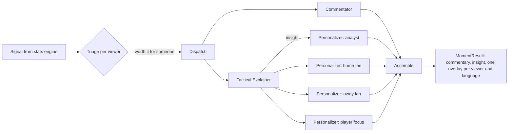

# Agents (Explain, Narrate, Personalize)

The agents turn the stats engine's signals into explanations, live commentary,
personalised on-screen overlays and recaps. They are built with **Microsoft Agent
Framework** and run on a **Microsoft Foundry** model deployment (`gpt-5-mini`),
authenticated with Microsoft Entra ID (no API keys).

## The team

| Agent | Kind | Role |
|---|---|---|
| Orchestrator | Code | Owns the shared match state, triages signals per viewer, runs moments concurrently, triggers recaps |
| Tactical Explainer | LLM | Why the moment matters: control vs chaos, pressing, rhythm, game state, individual quality |
| Commentator | LLM | One broadcast-ready line, aware of the previous moments |
| Personalizer | LLM, one per viewer and language | Overlay card in the viewer's language and level (analyst or casual), from their club's or player's point of view, including why the moment matters (and the analyst note for analysts) in that language |
| Player Analyst | LLM, one per followed player and language | A check-in on the player every 15 minutes (15', 30', half-time, 60', 75', full-time): what they have done, how well, what is missing |
| Verifier | Code | Rejects invented numbers, unknown player ids and texts too long for the screen |
| Recap Writer | LLM, one per viewer and language | Half-time and full-time recaps |
| Catch-up Writer | LLM, on request | "What you missed" for a fan joining late or coming back |
| Match Analyst | LLM with tools | Answers viewers' questions with live statistics, `simulate_what_if` (replays the rest of the match under a scenario) and graphic tools that draw on the pitch |

The Match Analyst's tools are also served to GitHub Copilot through an MCP server, so a
developer gets the same numbers in VS Code ([mcp.md](mcp.md)).

## One moment, end to end



The graph is an Agent Framework `Workflow` (`itg/agents/workflow.py`) with fan-out and fan-in
edges. The Commentator runs in parallel with the Explainer, so the commentary line is ready
first; the Personalizers start when the explanation is ready (the handoff) and run in parallel.

Every LLM call goes through the same guard (`itg/agents/team.py`):

1. Run the agent with a structured output schema (Pydantic).
2. The Verifier checks every number against the brief, plus lengths and ids.
3. If rejected, the agent gets one retry with the Verifier's feedback.
4. If it still fails, times out or Foundry is unreachable, a deterministic template takes over.

Each step is recorded in the moment's `trace` (agent, status, latency, reason).

## Shared state

- The stats engine: live team and player stats, momentum, game phase.
- The match memory: every processed moment with its explanation. It feeds the Commentator
  (continuity), the Recap Writer and the Match Analyst.
- The followed players: the Player Analyst gets their live statistics and the moments that
  involved them since the last check-in.
- The viewer profiles: a role (mode, favourite club, favourite player, player-focus mode) written
  in one or more languages (English, French, Spanish, Portuguese); each pair is a profile.

## Triage

Not every signal deserves an overlay for everyone. A signal goes to a viewer when its
importance passes that viewer's threshold, which drops when their club or player is
involved. Analysts get more tactical signals (tactical shifts, phase changes), casual
fans more spectacle (top speeds, thunderbolts). In player-focus mode almost every moment
involving the followed player is shown.

## Run it

```bash
python -m itg.agents.run data/matches/exl-prg-42.json                # on Foundry, 4 languages
python -m itg.agents.run data/matches/exl-prg-42.json --languages en,fr
python -m itg.agents.run data/matches/exl-prg-42.json --offline      # templates only
python -m itg.agents.run data/matches/exl-prg-42.json --ask "Why are they losing?"
```

The output is saved in `data/runs/<match_id>.json` and can be replayed by the front end
without calling Foundry.

Calls to Foundry are capped (16 in parallel); a call refused for rate limiting (HTTP 429)
waits 3, 6 then 12 seconds before retrying.

## Measured on the recorded demo matches

Both runs were recorded with the 16 viewer feeds (4 roles x 4 languages) and a Player Analyst
check-in for every player, so they hold everything the front end can show.

| | Expected Ls 2-2 Press Gang | Carb Loaders 2-3 Benchwarmers FC |
|---|---|---|
| Moments explained | 33 | 37 |
| Lower thirds written | 356 | 412 |
| Player check-ins | 137 | 134 |
| Agent calls | 1,002 | 1,054 |
| Accepted first time | 998 | 1,045 |
| Corrected after Verifier feedback | 4 | 7 |
| Replaced by a template | 0 | 2 |

During development the Verifier also exposed its own blind spots (a sign dropped from a negative
momentum value, the other side of a possession share); both are now accepted, while genuinely
invented numbers are still rejected (see `tests/test_agents.py`).
