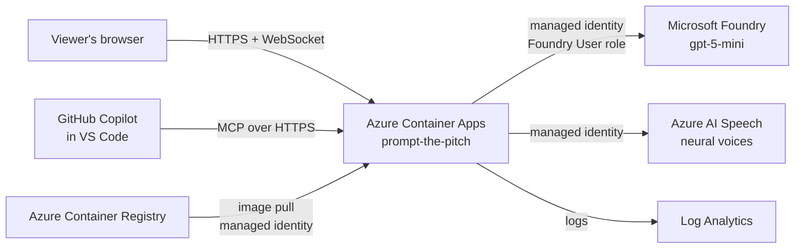

# Deployment on Azure

**Live demo:** https://prompt-the-pitch.bluemeadow-45cc0d52.swedencentral.azurecontainerapps.io

The app runs as a single container on **Azure Container Apps**. It calls the model deployed
in **Microsoft Foundry** with the app's **managed identity**: there is no API key in the code,
the image or the configuration.



| Resource | Name | Purpose |
|---|---|---|
| Resource group | `rg-insidethegame` | Everything below, in Sweden Central |
| Microsoft Foundry | `itg-foundry-ag26` / project `insidethegame` | Model deployment `gpt-5-mini` |
| Container Registry (Basic) | `itgacr<subscription prefix>` | Stores the image; the app pulls it with its managed identity (AcrPull) |
| Container Apps environment | `itg-env` | With its Log Analytics workspace |
| Container App | `prompt-the-pitch` | 1 vCPU, 2 GiB, one replica always on (watch rooms live in memory) |

## Deploy or update

```bash
az login
./infra/deploy.sh
```

The script is idempotent: it creates what is missing, builds a new image tag, grants the app's
identity **AcrPull** on the registry and **Foundry User** on the Foundry resource, connects the
registry (retrying while the role propagates), deploys the new image and waits until the new
revision is healthy. An update takes about 3 minutes.

The image is built locally for `linux/amd64` when Docker is available (on a Mac, Colima is
enough: `brew install colima docker docker-buildx && colima start --vm-type vz --vz-rosetta`).
`BUILD=acr` builds in Azure instead, but ACR Tasks are not available on subscriptions funded
by free trial credits.

## Configuration

| Variable | Meaning |
|---|---|
| `FOUNDRY_PROJECT_ENDPOINT` | Foundry project endpoint |
| `FOUNDRY_MODEL_DEPLOYMENT` | Model deployment name |
| `ITG_MAX_LIVE_SESSIONS` | Live sessions allowed at once (default 3). Extra viewers get the recorded run |
| `ITG_OFFLINE=1` | Run without Foundry (templates only) |

## Cost guards

Live sessions call Foundry for every key moment, so on a public URL they are capped (three at
a time), each viewer can ask the analyst at most 25 questions per match, and recorded runs
replay without any model call. Foundry calls are capped at 16 in parallel and back off on
rate limits.

## Operations

- Logs: `az containerapp logs show -n prompt-the-pitch -g rg-insidethegame --follow`
- Health: `GET /api/health` reports whether Foundry is connected.
- MCP: `POST /mcp` serves the tools for GitHub Copilot ([mcp.md](mcp.md)); they never call Foundry.
- Matches generated on the public site live in the container and disappear on restart; the
  demo matches and their recorded runs are part of the image.
- To remove everything after the hackathon: `az group delete -n rg-insidethegame`.
