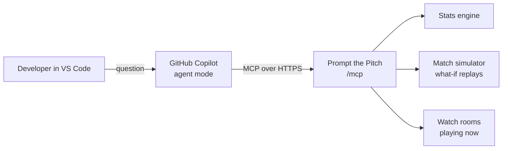

# Match intelligence in GitHub Copilot (MCP)

Prompt the Pitch serves its match intelligence as a **Model Context Protocol** server at
`/mcp`. A developer or a club analyst connects **GitHub Copilot in VS Code** to it and asks
about a recorded match, or about a watch room that is playing right now. Copilot calls the
tools, answers with real numbers, and can write code with the data (a win-probability chart,
a shot map in matplotlib, a scouting note).



## Connect

The repository already contains `.vscode/mcp.json`, so opening it in VS Code is enough:

```json
{
  "servers": {
    "prompt-the-pitch": {
      "type": "http",
      "url": "https://prompt-the-pitch.bluemeadow-45cc0d52.swedencentral.azurecontainerapps.io/mcp"
    }
  }
}
```

1. Open the folder in VS Code, open `.vscode/mcp.json` and click **Start** above the server.
2. Open Copilot Chat, switch to **Agent** mode: the Prompt the Pitch tools appear in the tools list.
3. Ask a question. No account, key or sign-in is needed: the data is synthetic and public.

For a local server, use `http://localhost:8000/mcp`. Any MCP client works the same way, for
example the MCP Inspector: `npx @modelcontextprotocol/inspector`, transport "Streamable HTTP".

## Example prompts

- *Which matches does Prompt the Pitch have? Who dominated Expected Ls v Press Gang, and why?*
- *In exl-prg-42, Press Gang led 2-1 at the hour and only drew 2-2. What if they had scored a
  third goal at 60'? Compare with what really happened.*
- *Plot the win probability of exl-prg-42 minute by minute with matplotlib and mark the goals.*
- *Draw Press Gang's shot map on a pitch, marker size = xG, goals in red.*
- *Join watch room A1B2C3: what is the score, who is the best player so far, and what happens if
  Expected Ls switch to a high press now?*

## Tools

Every match tool takes either `room` (a watch room code: the state the room has reached) or
`match_id` with an optional `minute` (a recorded match at that minute; full time otherwise).

| Tool | Returns |
|---|---|
| `list_matches` | Recorded matches with their final score, and the watch rooms open right now |
| `get_match_state` | Score, clock, momentum, game phase, win probabilities |
| `get_team_stats` | Possession, shots, xG, passes, pressing (PPDA), distance |
| `get_player_stats` | Goals, xG, passes, pass difficulty, top speed, distance, rating |
| `get_top_players` | Players ranked by a metric |
| `get_key_moments` | Key moments with why they mattered and their effect on win chances |
| `get_win_probability_timeline` | Win probability minute by minute, as rows ready to chart |
| `get_shot_map` | Every shot with its position, xG and outcome |
| `get_pass_network` | Average positions and the passes between players |
| `simulate_what_if` | Replays the rest of the match with a goal, red card, tactic or substitution, and compares |

Positions are in metres on a 105 × 68 pitch, in the team's attacking frame (towards x = 105).

## Design

- **Same tools as the analyst chat.** The MCP tools wrap the tools the in-app analyst agent
  uses (`itg/agents/chat.py`), so Copilot and the fans see the same numbers.
- **No model call, no cost.** The tools read the deterministic stats engine and the simulator;
  they never call Foundry. The language model is Copilot's.
- **No spoilers.** In a watch room, tools only see what the room has played, and a what-if can
  never start after the current minute.
- **Bounded.** What-if replays (200 runs with and without the scenario) are limited to 2 at a
  time and 20 a minute. The endpoint is stateless (`streamable HTTP`, JSON responses), so it
  scales with the app.
- **Readable errors.** An unknown room or match, or a what-if without a minute, comes back as a
  message the model can act on (for example "call list_matches").

The server is built with the official MCP Python SDK (`MCPServer`) and mounted in the FastAPI
app (`itg/api/mcp_server.py`).
